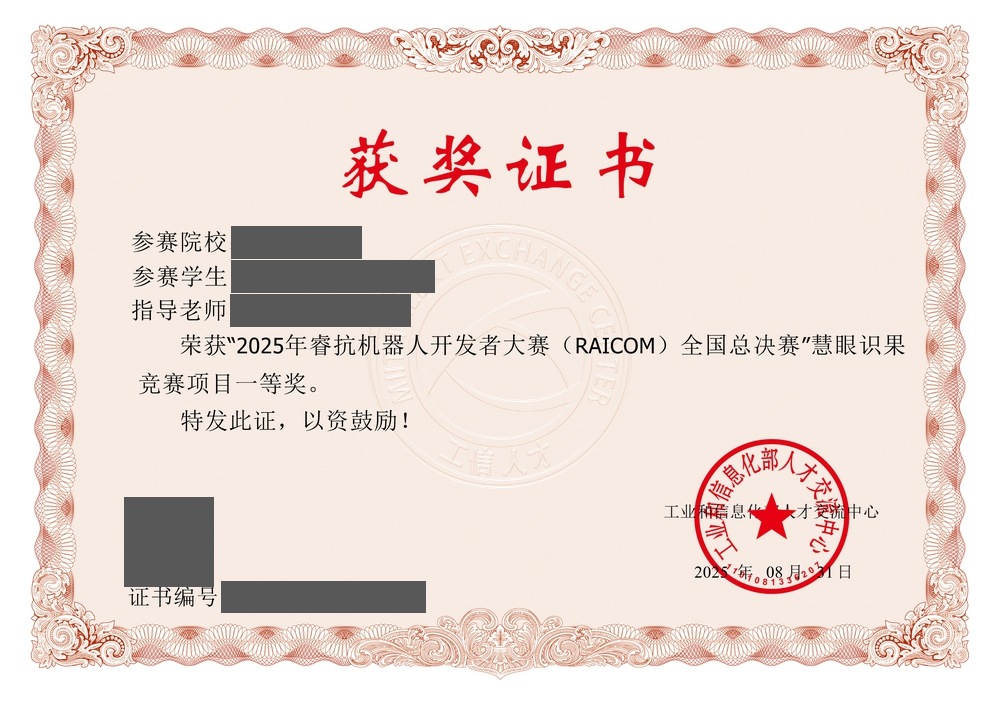

# 获奖证书



| 项目 | 内容 |
|---|---|
| 竞赛 | 2025 年睿抗机器人开发者大赛（RAICOM）全国总决赛 |
| 赛项 | 慧眼识果 |
| 奖项 | **一等奖** |
| 发证单位 | 工业和信息化部人才交流中心 |
| 发证日期 | 2025 年 08 月 22 日 |

本项目（K230 视觉端 + 树莓派控制端）即该赛项的参赛作品：
K230 负责"识果"（目标检测与中心对齐），树莓派负责三轴机械结构与夹爪执行。

---

## 打码说明

仓库公开可见，为避免个人信息泄漏，证书中以下内容已用**深灰实色条**遮盖：

| 已遮盖 | 原因 |
|---|---|
| 参赛院校 | 单位名称 |
| 参赛学生 | 获奖学生姓名 |
| 指导老师 | 指导老师姓名 |
| 证书编号 | 可验真的唯一编号 |
| **左下角二维码** | **验真链接，扫码即可查到持证人信息 —— 见下节** |

**刻意保留可见**：证书标题、赛事名称（RAICOM 全国总决赛）、赛项（慧眼识果）、
奖项等级（一等奖）、发证单位与日期，以及四个字段的**标签文字**
（「参赛院校」「参赛学生」「指导老师」「证书编号」）。
这样既能看出证书的可信度，又不会暴露具体是谁。

---

## ⚠️ 二维码：最容易漏掉的一处

证书左下角有一个二维码。它**不是装饰花纹**，解码后是一个**验真链接**：

```
https://cx.miitec.cn/certificateSearch?type=2&serialNumCode=<64 位十六进制流水号>
```

这是工信部人才交流中心的证书查询入口。带上那串流水号，**打开就能查到持证人信息** ——
比证书编号泄漏得更直接，因为它是一个可点击、可扫码的现成查询入口。
（具体流水号已随二维码一并遮盖，此处不复现。）

### 为什么值得单独写一节

**OCR 看不见二维码。** 对整页做 OCR 时它只会被读成乱码 —— 本项目这一遍
读成 `回 回`，一度被**误判为"装饰花纹"**，差点就留在了公开仓库里。
最后是靠**肉眼复核**加上用 `pyzbar` / OpenCV 专门解码才发现的。

> 如果你也要给证书打码：**务必在 OCR 之外，单独扫一遍二维码和条形码。**

---

## 打码可靠性是验证过的

1. **OCR 复检** —— 7 个敏感字符串（院校名、2 个学生名、2 个老师名、
   编号前缀与编号数字）在打码后全部**无法识别**。
2. **二维码复检** —— 打码后在 **3x / 4x / 6x / 8x** 四种放大倍数下用 pyzbar 重扫，
   全部**无法解出**。
3. **几何比对** —— 用打码前的 OCR 词框与实色条求交集：取值文字
   **100% 落在实色条内**（无泄漏）；标签文字 **0 像素被压到**（无误遮）。
4. **逐像素核对** —— 五条实色条区域均为严格单一颜色 **RGB(88, 88, 88)**，
   方差 **0.000**。
5. **无损保存** —— 以 PNG 格式入库（非 JPEG），不含任何压缩残影。

---

## 全图复核结论（肉眼 + 程序双重复核）

除上述 5 处遮盖外，证书上其余元素均与个人信息无关：

| 元素 | 内容 | 判定 |
|---|---|---|
| 右下红色印章 | **工业和信息化部人才交流中心**（含印章备案号 `1101081330201`） | **发证单位章，不是院校章**，非个人信息 |
| 印章旁文字 | 工业和信息化部人才交流中心 / 2025 年 08 月 22 日 | 发证单位与日期 |
| 中部水印 | `TEXCHANGE` / `工信人才` 圆形水印 | 发证单位水印 |
| 边框花纹 | 装饰纹样（8 倍放大后 OCR 返回 0 行文字） | 非文字 |
| 正文 | 赛事名称、赛项、奖项等级 | 刻意保留 |

**结论：除已遮盖的 5 处外，证书上没有发现其他个人信息。**

---

## 关于其他获奖

同一 `所获奖项/` 目录下还有 ROBOCON（全国大学生机器人大赛）、
中国机器人及人工智能大赛、山东省工程实践与创新能力大赛等证书，
都属于**其他比赛**，与本仓库（睿抗 RAICOM 慧眼识果赛项）无关，
因此未纳入本仓库。

> 注意：`rc*.png` 里的 "rc" 指的是 **ROBOCON**，不是睿抗（RAICOM）。
> 容易混淆，已核实。
